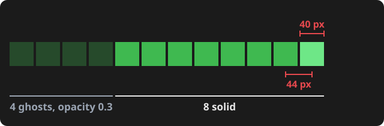

# Note: the Snake slides

Five slides about the Snake game, with speaker notes. On slide 3 the snake picture is animated: it restarts short and grows back segment by segment, and the older segments turn into ghosts.

- **Viewer:** [`snake.html`](snake.html), a self-contained file. Open it in a browser; press `S` for the speaker notes, `F` for fullscreen.
- **Script:** [`snake.qmd`](snake.qmd) is the slide source. [`snake_pic.py`](snake_pic.py) builds the snake picture ([`snake-pic.svg`](snake-pic.svg)) and the figure below, reading the ghost settings from the game itself.

## Dimensions

| Dimension | Value |
| --- | --- |
| Picture canvas | 640 × 150 px |
| Segment | 40 × 40 px, one every 44 px (gap 4 px) |
| Segments, final state | 12: 8 solid (opacity 1) + 4 ghosts (opacity 0.3) |
| Restart length | 3 segments |
| Animation | 5.5 s, plays once: final state, restart at 0.5 s, one segment every 0.45 s, then holds the final state |

The 8 and the 0.3 are not typed in twice: `snake_pic.py` reads them from `SOLID` and the ghost opacity in [`../snake/index.html`](../snake/index.html).

## Figure



## How the animation behaves

- The first frame is the final state (the full snake), and so is the picture without animation (print, reduced motion).
- The last frame is held (`fill="freeze"`, `repeatCount="1"`): it does not loop.
- It replays each time you arrive on slide 3.

## Rebuild

Needs [uv](https://docs.astral.sh/uv/) and [Quarto](https://quarto.org) (used: uv 0.13.1, Quarto 1.10.19; the script uses only the Python standard library). From the repository root:

```
uv run --no-project slides/snake_pic.py           # rewrite snake-pic.svg and snake-figure.svg, print the table
uv run --no-project slides/snake_pic.py --check   # confirm slides, note, figures and the game agree
quarto render slides/snake.qmd                    # rewrite snake.html
```
